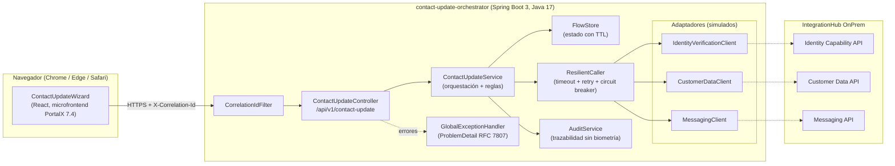
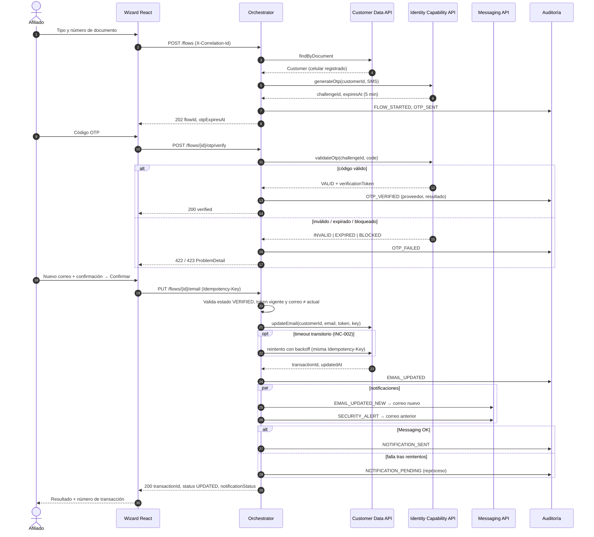

# E2. Diseño técnico

**HU-CONTACT-001: Actualización de correo electrónico del afiliado.**
Este diseño se apoya en los hechos y supuestos de [E1](E1_analisis_HU.md) (las referencias H-xx y S-xx remiten allí) y es el contrato que implementan `backend/` y `frontend/`.

---

## 1. Decisiones de arquitectura

| # | Decisión | Alternativa descartada | Motivo |
|---|----------|------------------------|--------|
| D-01 | **Frontend como componente React desacoplado** (asistente), integrable en **PortalX 7.4** como microfrontend. | Modificar el módulo *Actualización de Datos* de PortalX 7.0. | Roadmap: lo nuevo en 7.4 con componentes desacoplados (doc. 03); evita las librerías JS legadas, que fueron la causa de INC-001. Se valida con el LT (L-01). |
| D-02 | **Servicio orquestador nuevo** (`contact-update-orchestrator`, Spring Boot) que actúa como BFF: el navegador **nunca** llama directo a las APIs corporativas. | Llamar a las APIs desde el frontend. | Seguridad (secretos y tokens fuera del navegador), un solo punto para timeouts, reintentos, auditoría y `correlationId` (doc. 07, 11). |
| D-03 | El orquestador consume las APIs **a través de IntegrationHub OnPrem** mediante adaptadores (*ports & adapters*). | Construir en IntegrationHub Cloud. | Las capacidades productivas están en OnPrem y el doc. 05 permite mantenerlas allí (S-07). Con los adaptadores, migrar a Cloud solo cambia la URL base y el cliente. |
| D-04 | **Estado del flujo en el servidor** (`flowId` opaco con TTL). El token de verificación de identidad **no viaja al navegador**. | Token de verificación en el navegador (JWT). | Menor superficie de ataque y el orden de pasos se impone en el servidor (CA-10). Para la prueba, un almacén en memoria; en producción, Redis o la caché corporativa. |
| D-05 | **Notificación desacoplada del resultado**: si Messaging falla tras los reintentos, la actualización se mantiene y la notificación queda `PENDING`. | Revertir la actualización si falla la notificación. | Messaging no tiene SLA (H-04) y la HU prioriza el dato actualizado (S-05). |
| D-06 | Las tres APIs se **simulan** con adaptadores configurables (latencia y fallas por documento sintético). | Wiremock o contenedores. | Sin contratos reales ni ambientes (S-09); permite demostrar timeouts, reintentos y caída del proveedor en la sustentación. |

---

## 2. Componentes



### 2.1 Frontend (`frontend/`)

| Componente | Responsabilidad |
|------------|-----------------|
| `ContactUpdateWizard` | Máquina de estados del asistente (`useReducer`): `IDENTIFY → OTP → EMAIL → CONFIRM → RESULT`, más `ERROR`. Conserva el estado al reenviar el OTP. |
| `StepIdentify` | Tipo y número de documento con validación en línea. |
| `StepOtp` + `OtpCountdown` | Código de 6 dígitos, contador de vigencia, aviso a los 30 s y botón de reenvío con espera. |
| `StepEmail` | Nuevo correo y confirmación; validación de formato y coincidencia. |
| `StepConfirm` | Resumen enmascarado y botón *Confirmar* (deshabilitado mientras hay solicitud en curso). |
| `StepResult` | Resultado, número de transacción, fecha y estado de la notificación. |
| `api/client.js` | `fetch` con `X-Correlation-Id`, timeout con `AbortController`, `Idempotency-Key` y paso de `ProblemDetail` a errores de dominio. **Toda promesa con `catch`.** |
| `validation/*.js` | Reglas puras y reutilizables (documento, correo, OTP); son las mismas que se prueban con Vitest. |

### 2.2 Backend (`backend/`, paquete `com.colfondos.contactupdate`)

| Paquete | Clases principales |
|---------|--------------------|
| `api` | `ContactUpdateController`, DTOs de request y response (records con Bean Validation) |
| `service` | `ContactUpdateService`, `FlowStore`, `ContactFlow` (estado y transiciones) |
| `client` | Interfaces `IdentityVerificationClient`, `CustomerDataClient` y `MessagingClient`, más su implementación `Simulated*` |
| `resilience` | `ResilientCaller` (Resilience4j: `TimeLimiter`, `Retry` y `CircuitBreaker` por proveedor) |
| `audit` | `AuditService`, `AuditEvent` y `AuditRepository` (en memoria; en producción, el almacén corporativo según L-05) |
| `observability` | `CorrelationIdFilter` (MDC más header de respuesta), `Masking` (correo, documento y celular) |
| `error` | `GlobalExceptionHandler`, `ErrorCode` y `BusinessException` |
| `config` | `ContactUpdateProperties` (`@ConfigurationProperties` + `@Validated`: fail-fast si falta una variable, por INC-004) |

---

## 3. Contrato de la API del orquestador

Base: `/api/v1/contact-update` · `Content-Type: application/json` · Las fechas van en **ISO-8601 con offset** (`2026-10-22T21:03:00-05:00`).

Headers transversales:

| Header | Dirección | Uso |
|--------|-----------|-----|
| `X-Correlation-Id` | Request (opcional) / Response (siempre) | Si no llega, el backend genera un UUID. Se propaga a los adaptadores y al log. |
| `Idempotency-Key` | Request (en la actualización) | UUID generado por el frontend al confirmar. Un reintento con la misma clave devuelve el mismo resultado sin volver a actualizar. |

### 3.1 Iniciar el flujo y enviar el OTP
`POST /flows`

```json
// request
{ "documentType": "CC", "documentNumber": "1012345678" }
// 202 Accepted
{
  "flowId": "6f1c3b0e-…",
  "otpChannel": "SMS",
  "otpExpiresAt": "2026-10-22T21:08:00-05:00",
  "resendAvailableAt": "2026-10-22T21:03:30-05:00",
  "message": "Si los datos corresponden a un afiliado, enviamos un código al celular registrado."
}
```
Para evitar la enumeración de usuarios (CA-03), la respuesta es **idéntica** aunque el afiliado no exista: se crea un flujo "señuelo" que siempre falla al validar.

### 3.2 Reenviar el OTP
`POST /flows/{flowId}/otp/resend` → `202` con el mismo cuerpo de 3.1. Responde `429 OTP_RESEND_TOO_SOON` si no se ha cumplido la espera.

### 3.3 Validar el OTP
`POST /flows/{flowId}/otp/verify`

```json
// request
{ "code": "123456" }
// 200 OK
{ "verified": true, "verifiedUntil": "2026-10-22T21:09:10-05:00" }
```
Errores: `422 OTP_INVALID` (incluye `remainingAttempts`), `422 OTP_EXPIRED`, `423 OTP_BLOCKED`.

### 3.4 Actualizar el correo
`PUT /flows/{flowId}/email` · Header `Idempotency-Key`

```json
// request
{ "newEmail": "nuevo.correo@dominio.com", "confirmEmail": "nuevo.correo@dominio.com" }
// 200 OK
{
  "transactionId": "TX-20261022-8F3A1C",
  "status": "UPDATED",
  "maskedEmail": "nu***@dominio.com",
  "updatedAt": "2026-10-22T21:04:12-05:00",
  "notificationStatus": "SENT"
}
```
`notificationStatus` puede ser `SENT` o `PENDING` (D-05). Errores: `403 IDENTITY_NOT_VERIFIED`, `422 EMAIL_SAME_AS_CURRENT`, `400 VALIDATION_ERROR`, `503` o `504` del proveedor.

### 3.5 Puertos hacia las APIs corporativas (adaptadores)

| Puerto | Operación | Mapea a | Notas |
|--------|-----------|---------|-------|
| `CustomerDataClient` | `findByDocument(type, number) → Optional<Customer>` | Customer Data API: consulta de perfil | `Customer{customerId, email, mobilePhone, status}` |
| | `updateEmail(customerId, email, verificationToken, idempotencyKey) → UpdateResult` | Customer Data API: actualización de contacto | Exige el token de identidad (H-01). Es idempotente por clave, así que **se puede reintentar**. |
| `IdentityVerificationClient` | `generateOtp(customerId, channel) → OtpChallenge` | Identity Capability: generación | `{challengeId, expiresAt}`. El orquestador **nunca** ve ni registra el código. |
| | `validateOtp(challengeId, code) → OtpValidation` | Identity Capability: validación y registro | `{result: VALID\|INVALID\|EXPIRED\|BLOCKED, remainingAttempts, verificationToken}` |
| `MessagingClient` | `sendEmail(to, templateId, params) → MessageReceipt` | Messaging API: correo | Plantillas `EMAIL_UPDATED_NEW` y `EMAIL_UPDATED_SECURITY_ALERT`. |

---

## 4. Diagrama de secuencia (camino feliz y fallas)



---

## 5. Manejo de errores

### 5.1 Formato único (RFC 7807 `ProblemDetail`)
```json
{
  "type": "https://colfondos.example/errors/otp-invalid",
  "title": "Código incorrecto",
  "status": 422,
  "code": "OTP_INVALID",
  "detail": "El código ingresado no es válido.",
  "remainingAttempts": 2,
  "correlationId": "c7a1…"
}
```
El `GlobalExceptionHandler` (`@RestControllerAdvice`) es el **único** lugar donde una excepción se convierte en una respuesta HTTP. Nunca expone stack traces, nombres de clases ni detalle del proveedor.

### 5.2 Catálogo de errores

| `code` | HTTP | Causa | Mensaje al afiliado (frontend) | Reintentable por el usuario |
|--------|------|-------|--------------------------------|-----------------------------|
| `VALIDATION_ERROR` | 400 | Bean Validation | Mensaje por campo | Sí |
| `FLOW_NOT_FOUND` | 404 | `flowId` inexistente o vencido | "Tu sesión expiró. Vuelve a empezar." | Reinicia |
| `OTP_INVALID` | 422 | Código incorrecto | "Código incorrecto. Te quedan N intentos." | Sí |
| `OTP_EXPIRED` | 422 | Vigencia superada (INC-003) | "Tu código expiró. Solicita uno nuevo." + botón | Reenvío |
| `OTP_BLOCKED` | 423 | 3 intentos fallidos | "Por seguridad bloqueamos el proceso. Comunícate con…" | No |
| `OTP_RESEND_TOO_SOON` | 429 | Reenvío antes de 30 s | "Podrás reenviar en N s." | Espera |
| `RATE_LIMITED` | 429 | Demasiados flujos por documento o IP | "Intenta más tarde." | Espera |
| `IDENTITY_NOT_VERIFIED` | 403 | Actualización sin OTP válido o con token vencido | "Debes validar tu identidad." | Reinicia |
| `EMAIL_SAME_AS_CURRENT` | 422 | Correo igual al registrado | "El nuevo correo debe ser distinto al actual." | Sí |
| `PROVIDER_TIMEOUT` | 504 | Timeout tras los reintentos (INC-002) | "El servicio tarda más de lo normal. Intenta de nuevo." | Sí |
| `PROVIDER_UNAVAILABLE` | 503 | 5xx tras reintentos o circuito abierto (INC-005) | "No pudimos validar tu identidad en este momento." | Más tarde |
| `INTERNAL_ERROR` | 500 | No controlado | Mensaje genérico + `correlationId` para soporte | — |

### 5.3 Resiliencia ante proveedores externos (INC-002, INC-005)

| Proveedor | Timeout por intento | Reintentos | Backoff | Se reintenta ante | Circuit breaker |
|-----------|--------------------|------------|---------|-------------------|-----------------|
| Customer Data: consulta | 3 s | 2 (3 intentos) | 200 ms × 2 | Timeout, 5xx, error de red | 50 % de fallos en 20 llamadas → abierto 30 s |
| Customer Data: actualización | 3 s | 2 | 200 ms × 2 | Timeout y 5xx, **solo porque usa `Idempotency-Key`** | Igual |
| Identity: generar y validar | 3 s | 1 | 300 ms | Timeout y 5xx. **Nunca** se reintenta un `INVALID` | Igual (INC-005) |
| Messaging | 2 s | 2 | 500 ms × 2 | Timeout y 5xx | No; si falla queda `PENDING` (D-05) |

- **No se reintentan** errores 4xx ni resultados de negocio (`OTP_INVALID`, etc.).
- **Presupuesto de tiempo:** en el peor caso, la validación de identidad toma 3 s × 2 + 0,3 s ≈ 6,3 s, muy por debajo de 60 s (H-11). Si el circuito está abierto se falla rápido, sin hacer esperar al afiliado.
- **Frontend:** timeout de 15 s por petición con `AbortController`. Si se vence el tiempo en la confirmación, el reintento reutiliza la **misma** `Idempotency-Key`.

---

## 6. Seguridad

| Control (doc. 08) | Implementación |
|-------------------|----------------|
| TLS ≥ 1.2 | Terminación TLS en el balanceador o en IntegrationHub; HSTS. El servicio no expone HTTP en producción. |
| Gestión de secretos | Credenciales de IntegrationHub por **variables de ambiente** o bóveda corporativa; nunca en el repositorio (`.gitignore` excluye `.env`; `.env.example` sin valores reales). |
| Validación de entradas | Bean Validation en el backend (autoridad) y la misma regla en el frontend (experiencia). Listas cerradas para `documentType`. JSON con propiedades desconocidas rechazadas. |
| OWASP A01: control de acceso | El orden de los pasos se impone en el servidor; actualizar exige un flujo `VERIFIED` con token vigente y de un solo uso (CA-10). |
| OWASP A04: diseño inseguro / enumeración | Respuesta idéntica para afiliados existentes e inexistentes (CA-03); rate limiting por documento e IP; bloqueo tras 3 OTP fallidos. |
| OWASP A07: autenticación | OTP con vigencia de 5 min, 3 intentos y espera de 30 s para reenviar (S-03). El código **no** se registra en logs ni en auditoría. |
| OWASP A09: registro y monitoreo | Eventos de seguridad (`OTP_BLOCKED`, `IDENTITY_NOT_VERIFIED`, `RATE_LIMITED`) en la auditoría con `correlationId`. |
| CORS | Solo los orígenes del portal (`CORS_ALLOWED_ORIGINS`). |
| Datos biométricos | **No** se capturan en esta HU. Si a futuro hay validación facial, la imagen va directo al proveedor y el canal solo conserva `transactionId`, resultado, proveedor y fecha/hora (H-08). |
| PII en logs | Enmascaramiento: correo `an***@dominio.com`, documento `******5678`, celular `300****567`. |
| Escaneo de código seguro | Paso obligatorio antes de producción (3 días hábiles; L-07), incluido en el plan de E3. |

> **Supuesto S-10:** el flujo es accesible **sin sesión** del portal, porque el problema de negocio es justamente que el afiliado no logra completar la verificación con sus datos actuales. Si el PO define que exige sesión, el `customerId` sale del token de sesión y se elimina el paso de identificación.

---

## 7. Trazabilidad y observabilidad

### 7.1 Registro de auditoría (`AuditEvent`)

| Campo | Ejemplo | Nota |
|-------|---------|------|
| `eventId` | UUID | |
| `transactionId` | `TX-20261022-8F3A1C` | Lo emite Customer Data al actualizar; antes de eso se usa `flowId`. |
| `flowId` | UUID | |
| `correlationId` | UUID | Une frontend, backend y llamadas a proveedores. |
| `eventType` | `FLOW_STARTED`, `OTP_SENT`, `OTP_VERIFIED`, `OTP_FAILED`, `OTP_BLOCKED`, `EMAIL_UPDATED`, `NOTIFICATION_SENT`, `NOTIFICATION_PENDING`, `SECURITY_EVENT` | |
| `result` | `SUCCESS` / `FAILURE` | |
| `provider` | `IDENTITY_CAPABILITY`, `CUSTOMER_DATA`, `MESSAGING` | Permitido por el doc. 08. |
| `customerRef` | SHA-256 del documento | Permite correlacionar sin exponer el documento. |
| `browser` | `Safari 17` | Derivado del `User-Agent`; sirve para los indicadores por navegador (doc. 11). |
| `occurredAt` | ISO-8601 | |
| **Excluido** | Imágenes, video o plantillas faciales, OTP, token de verificación y correo en claro | doc. 08 |

### 7.2 Logs estructurados
- Formato JSON con el *structured logging* nativo de Spring Boot 3.4 (`logging.structured.format.console=ecs`).
- Campos MDC en cada línea: `correlationId`, `flowId`, `step`, `provider`, `attempt`, `durationMs`.
- Cada llamada a un proveedor registra inicio y fin, con duración, resultado e intento.

### 7.3 Métricas (Micrometer)
| Métrica | Tags | KPI (doc. 11 y 14) |
|---------|------|--------------------|
| `contact_update_flow_total` | `result`, `browser` | Tasa de éxito y errores por navegador |
| `contact_update_step_duration` | `step` | Tiempo de validación (< 60 s) y del flujo (< 3 min) |
| `provider_call_duration` | `provider`, `outcome` | Latencia de las APIs y disponibilidad del proveedor |
| `contact_update_abandon_total` | `lastStep` | Tasa de abandono (flujo vencido sin completar) |

---

## 8. Configuración (variables de ambiente)

Todas se validan al arrancar (fail-fast). Si falta una obligatoria, el servicio **no arranca** y el error nombra la variable (lección de INC-004).

| Variable | Default (local) | Obligatoria en prod. |
|----------|-----------------|----------------------|
| `SERVER_PORT` | `8080` | No |
| `CORS_ALLOWED_ORIGINS` | `http://localhost:5173` | **Sí** |
| `OTP_TTL` | `PT5M` | No |
| `OTP_MAX_ATTEMPTS` | `3` | No |
| `OTP_RESEND_COOLDOWN` | `PT30S` | No |
| `FLOW_TTL` | `PT10M` | No |
| `PROVIDER_CUSTOMER_DATA_URL` | `sim://customer-data` | **Sí** |
| `PROVIDER_IDENTITY_URL` | `sim://identity` | **Sí** |
| `PROVIDER_MESSAGING_URL` | `sim://messaging` | **Sí** |
| `PROVIDER_TIMEOUT` | `PT3S` | No |
| `SIM_FIXED_OTP` | `123456` (solo perfil `sim`) | **Prohibida** en prod. |
| `VITE_API_BASE_URL` (frontend) | `http://localhost:8080` | **Sí** |

---

## 9. Datos sintéticos (perfil `sim`)

| Documento | Comportamiento simulado | Criterio |
|-----------|-------------------------|----------|
| CC `1012345678` | Camino feliz | CA-01 |
| CC `1000000001` | Customer Data: timeout en el 1.er intento y OK en el 2.º | CA-12 |
| CC `1000000002` | Identity Capability caído (5xx permanente) | CA-13 |
| CC `1000000003` | Messaging falla siempre → `PENDING` | CA-14 |
| CC `1000000004` | Correo actual = `actual@correo.com` (para probar "igual al actual") | CA-08 |
| Cualquier otro | Afiliado inexistente (respuesta señuelo) | CA-03 |

OTP en simulación: el valor de `SIM_FIXED_OTP`. Ningún dato corresponde a una persona real.

---

## 10. Plantilla de diseño técnico Dev (sección 8 de la prueba)

| Campo | Respuesta |
|-------|-----------|
| **Componente frontend** | `ContactUpdateWizard` (React + Vite), microfrontend desacoplado para PortalX 7.4 (D-01): pasos `StepIdentify`, `StepOtp` + `OtpCountdown`, `StepEmail`, `StepConfirm` y `StepResult`; `api/client.js` con correlationId, timeout e idempotencia; validaciones puras en `validation/`. Sin dependencias de librerías legadas de PortalX 7.0. |
| **Servicio/API** | Nuevo BFF `contact-update-orchestrator` (Spring Boot 3, Java 17) con 4 endpoints REST (`POST /flows`, `POST /flows/{id}/otp/resend`, `POST /flows/{id}/otp/verify`, `PUT /flows/{id}/email`). Consume vía IntegrationHub OnPrem: **Customer Data API** (consulta y actualización), **Identity Capability API** (generar y validar OTP) y **Messaging API** (correo de confirmación y alerta), mediante adaptadores intercambiables por Cloud. |
| **Validaciones** | Frontend: formato de documento, OTP de 6 dígitos, correo RFC 5322 simplificado y ≤ 254, coincidencia de confirmación, contador y aviso de expiración, bloqueo de doble envío. Backend (autoridad): Bean Validation, orden de pasos (`VERIFIED` obligatorio), token vigente de un solo uso, correo ≠ actual, 3 intentos de OTP, espera de reenvío, rate limiting, idempotencia. |
| **Manejo de errores** | `@RestControllerAdvice` único con `ProblemDetail` (RFC 7807) y `code` estable (catálogo de 12 códigos). Resilience4j por proveedor: timeout de 3 s, reintentos con backoff solo ante fallas transitorias, circuit breaker para Identity (INC-005). Messaging no bloquea: `PENDING` y reproceso. El frontend traduce el `code` a un mensaje claro y captura **todas** las promesas (INC-001). |
| **Datos sintéticos** | Perfil `sim` con 5 documentos que disparan cada escenario (feliz, timeout con reintento, Identity caído, Messaging caído, correo igual) y un OTP fijo por variable de ambiente. Sin datos reales. |
| **Logs/correlationId** | `CorrelationIdFilter`: toma `X-Correlation-Id` o genera un UUID, lo pone en el MDC y en el header de respuesta, y lo propaga a los proveedores. Logs JSON (ECS) con `flowId`, `step`, `provider`, `attempt` y `durationMs`; PII enmascarada; nunca OTP ni biometría. Auditoría con `transactionId`, resultado, proveedor, fecha/hora y navegador. Métricas Micrometer por navegador y por paso. |
| **Pruebas** | JUnit 5 + Mockito (servicio, reglas de OTP y enmascaramiento), MockMvc (contrato HTTP, ProblemDetail, correlationId), Vitest + Testing Library (validaciones, asistente, expiración del OTP, manejo de rechazos), compatibilidad con Safari (WebKit) y proveedor caído con los datos sintéticos. Detalle en E5. |
| **README/PR** | README con requisitos, arranque local (`mvn spring-boot:run -Dspring-boot.run.profiles=sim`, `npm run dev`), tabla de variables y `.env.example`, documentos de prueba y endpoints. PR con la plantilla del repositorio: descripción, evidencias, checklist de INC-001 a INC-004, biometría, correlationId y sección de uso de IA. Detalle en E3. |
