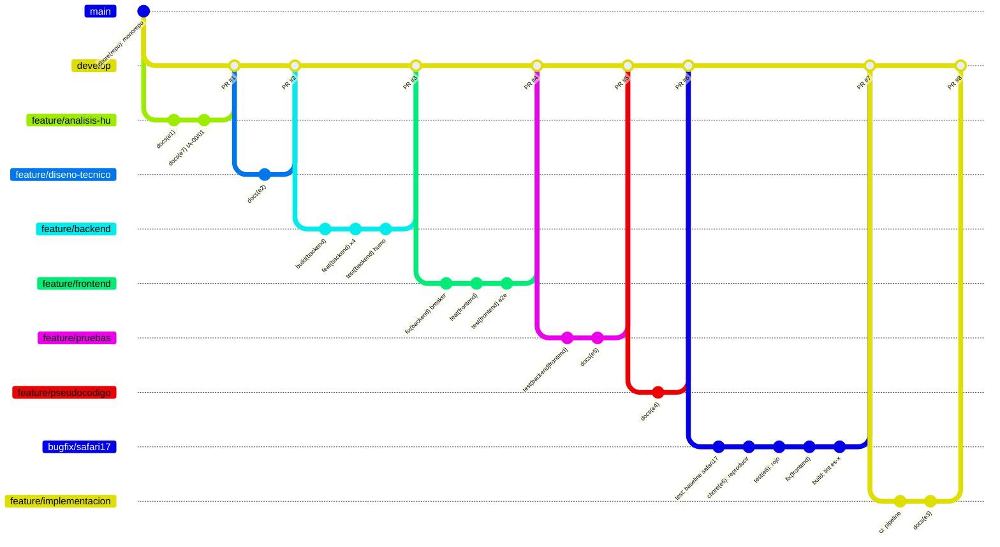
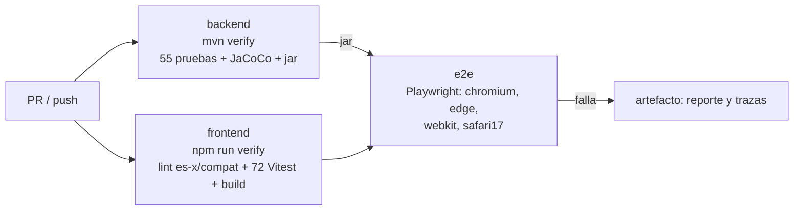

# E3. Implementación

**HU-CONTACT-001.** Tareas técnicas, estructura, estrategia de ramas, configuración local, pipeline CI, Pull Requests y plan de despliegue. Repositorio: <https://github.com/Hubrigo/colfondos_prueba>.

---

## 1. Tareas técnicas

### 1.1 Ejecutadas en esta prueba

| ID | Tarea | Capa | Estimado | PR | Estado |
|----|-------|------|----------|----|--------|
| T-01 | Monorepo, Git Flow, plantilla de PR y protección de ramas | Repo | 0,5 h | inicial, #1 | ✅ |
| T-02 | Esqueleto Spring Boot 3.5 / Java 17 con propiedades validadas (fail-fast) | Backend | 1 h | #3 | ✅ |
| T-03 | Puertos de las 3 APIs, catálogo de errores, `GlobalExceptionHandler`, `CorrelationIdFilter` y enmascaramiento | Backend | 2 h | #3 | ✅ |
| T-04 | `ResilientCaller`: timeout, reintento y circuit breaker por proveedor | Backend | 2 h | #3, #4 | ✅ |
| T-05 | Orquestación de los 4 endpoints, estado del flujo, idempotencia, rate limiting y auditoría | Backend | 4 h | #3 | ✅ |
| T-06 | Adaptadores simulados y datos sintéticos por escenario | Backend | 1,5 h | #3 | ✅ |
| T-07 | Asistente React: máquina de estados, 5 pasos, cliente HTTP y validaciones | Frontend | 5 h | #4 | ✅ |
| T-08 | E2E Playwright en Chromium, Edge, WebKit y `safari17` | Frontend | 2 h | #4, #7 | ✅ |
| T-09 | Pruebas unitarias e integración: JUnit, Mockito, MockMvc y Vitest | Ambos | 4 h | #5 | ✅ |
| T-10 | Defecto de Safari 17 en la confirmación: reproducción, fix y regresión | Frontend | 3 h | #7 | ✅ |
| T-11 | Lint de compatibilidad (`es-x` + `compat`) | Frontend | 0,5 h | #7 | ✅ |
| T-12 | Pipeline CI (GitHub Actions) | DevOps | 1 h | #8 | ✅ |
| T-13 | Documentación E1–E7, README y variables | Docs | 4 h | #1, #2, #5–#8 | ✅ |

### 1.2 Pendientes para llevar a producción (fuera del alcance de la prueba)

| ID | Tarea | Depende de | Prioridad |
|----|-------|------------|-----------|
| T-14 | Adaptadores reales de IntegrationHub OnPrem (REST/SOAP) y pruebas de contrato contra QA | L-02, L-03 (contratos y timeouts reales) | Alta |
| T-15 | `FlowStore` e idempotencia en Redis o la caché corporativa (multi-instancia) | L-05 | Alta |
| T-16 | Integración del asistente como microfrontend en PortalX 7.4 (o adaptación a 7.0) | L-01 | Alta |
| T-17 | Autenticación de servicio a servicio, cabeceras de seguridad y TLS en el borde | Ciberseguridad | Alta |
| T-18 | Formato de evaluación de ciberseguridad (doc. 08) y escaneo de código seguro (3 días hábiles) | T-14 a T-17 | Alta, en la ruta crítica |
| T-19 | Outbox o cola para notificaciones `PENDING` y su reproceso | L-06 | Media |
| T-20 | Persistir la auditoría en el almacén corporativo | L-05 | Media |
| T-21 | Tableros de observabilidad: éxito, abandono, latencia por proveedor y errores por navegador (doc. 11) | Operación Digital | Media |
| T-22 | Certificación en Safari 17 real, macOS e iOS (E5 C-06) | QA | Alta |
| T-23 | Flujo alterno cuando el celular también está desactualizado | P-01, P-04 (PO) | Depende de la respuesta del PO |

---

## 2. Estructura

Detalle en el [README](../README.md#estructura). Es un monorepo con `backend/` (Maven), `frontend/` (npm), `docs/`, `scripts/` y `.github/`. El backend aplica *ports & adapters*: los adaptadores simulados (`client/sim`, perfil `sim`) se reemplazan por los de IntegrationHub sin tocar el servicio (D-03).

---

## 3. Estrategia de ramas

Git Flow simplificado ([CONTRIBUTING.md](../CONTRIBUTING.md)):

| Rama | Uso | Protección en GitHub |
|------|-----|----------------------|
| `main` | Producción; recibe `release/*` y `hotfix/*` | PR obligatorio (también para administradores), sin force-push ni borrado, conversaciones resueltas |
| `develop` | Integración | Igual |
| `feature/HU-CONTACT-001-<paso>` | Un paso o tarea técnica | — |
| `bugfix/HU-CONTACT-001-<defecto>` | Defecto reportado por QA antes de liberar | — |
| `release/<versión>` | Estabilización antes del comité | — |
| `hotfix/<incidente>` | Urgencia sobre `main` | — |

Solo se permite **merge commit** (equivale a `--no-ff`), para que cada PR quede visible en el historial. Historial real de `develop`:



**Revisión de PRs:** cada PR tiene una revisión registrada con el checklist verificado. La aprobación formal no fue posible porque GitHub no permite que el autor apruebe su propio PR (cuenta única). En el equipo real: **1 aprobación o más**, más los *status checks* de CI como requisito de merge (§6).

---

## 4. Commits

[Conventional Commits](https://www.conventionalcommits.org/) con `Refs: HU-CONTACT-001`, y el *trailer* `AI-Assisted:` cuando el código fue asistido por IA (vincula con E7).

| Tipo | Cantidad | Ejemplo |
|------|---------:|---------|
| `docs` | 13+ | `docs(e6): documentar el debug de Safari 17 para el LT` |
| `test` | 6 | `test(e6): aislar el defecto de Safari 17 y agregar pruebas de regresión en rojo` |
| `feat` | 5 | `feat(backend): aplicar timeout, reintentos y circuit breaker por proveedor` |
| `fix` | 2 | `fix(frontend): confirmar la actualización en Safari 17.0–17.3` |
| `build` / `chore` / `ci` | 5 | `ci: agregar pipeline de GitHub Actions para backend, frontend y e2e` |

- 13 commits llevan `AI-Assisted:` con lo que se validó o corrigió.
- Los commits de una rama compilan por separado (se verificó en la rama del backend con un *worktree* por commit), así el historial se puede bisecar. La excepción **deliberada** es el commit `test(e6)`, que deja pruebas en rojo para mostrar el ciclo rojo → verde.
- El commit `chore(e6): reintroducir a propósito…` está marcado explícitamente como reproducción, no como funcionalidad.

---

## 5. Configuración local

Comandos, documentos de prueba y solución de problemas: [README → Arranque local](../README.md#arranque-local).

**Variables de ambiente** (tabla completa en el [README](../README.md#variables-de-ambiente)):

- El backend las valida con `@ConfigurationProperties` + `@Validated`. Si falta una obligatoria, el arranque falla nombrando cada propiedad. Lo cubre `ContactUpdatePropertiesTest` y la evidencia está en `docs/evidencias/backend-failfast-sin-variables.txt`.
- En el frontend, si falta `VITE_API_BASE_URL` en build, la app muestra un error de configuración en lugar de arrancar a medias.
- **Plantillas:** [`backend/.env.example`](../backend/.env.example) y [`frontend/.env.example`](../frontend/.env.example), ambas versionadas. Variables del backend:

```dotenv
# Obligatorias fuera del perfil sim
CORS_ALLOWED_ORIGINS=http://localhost:5173
PROVIDER_CUSTOMER_DATA_URL=sim://customer-data
PROVIDER_IDENTITY_URL=sim://identity
PROVIDER_MESSAGING_URL=sim://messaging
# Opcionales (default)
SERVER_PORT=8080
OTP_TTL=PT5M
OTP_MAX_ATTEMPTS=3
OTP_RESEND_COOLDOWN=PT30S
OTP_MAX_RESENDS=3
FLOW_TTL=PT10M
RATE_LIMIT_MAX_FLOWS_PER_DOCUMENT=5
RATE_LIMIT_MAX_FLOWS_PER_IP=30
RATE_LIMIT_WINDOW=PT15M
PROVIDER_TIMEOUT=PT3S
PROVIDER_MESSAGING_TIMEOUT=PT2S
# Solo perfil sim (prohibidas en producción)
SIM_FIXED_OTP=123456
SIM_SLOW_CALL_DELAY=PT4S
```

- **Secretos:** `.env` y `.env.*` están en `.gitignore`, salvo los `.env.example`. En producción, las credenciales de IntegrationHub van en la bóveda corporativa, no en archivos.

---

## 6. Pipeline CI

[`.github/workflows/ci.yml`](../.github/workflows/ci.yml) corre en cada PR y en cada push a `develop` o `main`:



| Job | Qué bloquea | Artefactos |
|-----|-------------|------------|
| `backend` | Reglas de la HU, contrato HTTP y fail-fast de configuración (INC-004) | Reporte JaCoCo, jar |
| `frontend` | APIs posteriores a Safari 17.0 (lint), regresiones de UI y build | — |
| `e2e` | Flujo real en los 4 proyectos y errores de consola (INC-001) | Reporte Playwright y trazas si falla |

**Lección de E6:** el defecto de Safari 17 lo detectaban pruebas Vitest que ya existían (CA-12, INC-001), pero nadie las corría antes de QA. Con este pipeline como **check obligatorio de merge**, ese defecto no habría salido de la rama.

Resultado de la primera ejecución: ver §6.1.

### 6.1 Ejecución

Primera ejecución, en el PR #8 ([run 39896533996](https://github.com/Hubrigo/colfondos_prueba/actions/runs/39896533996)), **verde al primer intento** en `ubuntu-latest`:

| Job | Resultado | Duración | Detalle |
|-----|-----------|----------|---------|
| Backend · mvn verify | ✅ | 45 s | `Tests run: 55, Failures: 0, Errors: 0` |
| Frontend · lint + Vitest + build | ✅ | 24 s | lint limpio · 72/72 · build |
| E2E · Chromium, Edge, WebKit, safari17 | ✅ | 126 s | `26 passed`, 6 omitidas (bisección solo en WebKit) |

Lo que corría en Windows también corre en Linux, así que las pruebas no dependen del equipo de desarrollo. Tras esta ejecución, los 3 jobs quedaron como **status checks obligatorios** para hacer merge en `develop` y `main` (protección de ramas, modo *strict*: la rama debe estar al día con la base).

---

## 7. Pull Requests

Plantilla: [`.github/pull_request_template.md`](../.github/pull_request_template.md). Incluye descripción, tipo, evidencias (CI y suites), **checklist de lecciones aprendidas INC-001 a INC-004**, biometría, observabilidad, **despliegue** (comité, escaneo de ciberseguridad, variables a Operación TI) y uso de IA.

| PR | Rama | Contenido |
|----|------|-----------|
| [#1](https://github.com/Hubrigo/colfondos_prueba/pull/1) | `feature/…-analisis-hu` | E1 |
| [#2](https://github.com/Hubrigo/colfondos_prueba/pull/2) | `feature/…-diseno-tecnico` | E2 |
| [#3](https://github.com/Hubrigo/colfondos_prueba/pull/3) | `feature/…-backend` | Orquestador Spring Boot |
| [#4](https://github.com/Hubrigo/colfondos_prueba/pull/4) | `feature/…-frontend` | Asistente React + e2e |
| [#5](https://github.com/Hubrigo/colfondos_prueba/pull/5) | `feature/…-pruebas` | Suites y matriz E5 |
| [#6](https://github.com/Hubrigo/colfondos_prueba/pull/6) | `feature/…-pseudocodigo` | E4 |
| [#7](https://github.com/Hubrigo/colfondos_prueba/pull/7) | `bugfix/…-safari17-confirmacion` | **E6: PR de referencia** (causa raíz, historial rojo → verde y evidencias) |
| [#8](https://github.com/Hubrigo/colfondos_prueba/pull/8) | `feature/…-implementacion` | E3 + pipeline CI |

---

## 8. Plan de despliegue (doc. 12)

```text
develop ──► release/0.1.0 ──► QA (certificación) ──► comité (martes 11:00) ──► main ──► ventana ≥ 21:00
```

| Fase | Actividad | Responsable | Evidencia |
|------|-----------|-------------|-----------|
| 1. Estabilización | Crear `release/0.1.0` desde `develop`; solo correcciones (`bugfix/*`) | Dev | CI en verde |
| 2. Ciberseguridad | Formato de evaluación (flujos, datos tratados, componentes expuestos, controles) y escaneo de código seguro: **3 días hábiles** | Dev + Ciberseguridad | Informe sin hallazgos críticos |
| 3. QA | Funcionales, negativas, regresión, **Safari 17 real (C-06)**, Chrome, Edge e indisponibilidad de proveedores | QA | Estado de certificación (doc. 09) |
| 4. Comité | Presentación el **martes a las 11:00 AM** con el checklist de variables | LT | Acta del comité |
| 5. Despliegue | Merge `release → main` + tag `v0.1.0`; ventana **después de las 9:00 PM** | Operación TI | Log del despliegue |
| 6. Verificación | Arranque sin error de configuración (fail-fast), `GET /actuator/health`, flujo con referente funcional | Dev + referente | Validación funcional |
| 7. Cierre | Informar en el canal oficial de gerencia y en el operativo de despliegues; cerrar el caso en Mesa de Servicio con evidencias | LT | Caso cerrado |

**Checklist previo a la ventana (lección de INC-004):**
- [ ] Las 4 variables obligatorias definidas en el ambiente destino (`CORS_ALLOWED_ORIGINS`, `PROVIDER_*_URL`)
- [ ] `SIM_FIXED_OTP` y `SIM_SLOW_CALL_DELAY` **ausentes**, y el perfil `sim` **no** activo
- [ ] Credenciales de IntegrationHub en la bóveda
- [ ] Arranque en un ambiente previo con la misma configuración (el fail-fast falla en minutos, no en la ventana)

**Rollback:** redeploy del artefacto anterior. El cambio no altera esquemas de datos: la actualización de correo la hace Customer Data. El fail-fast convierte un error de configuración en un arranque fallido inmediato y visible, en lugar de un servicio que arranca a medias.

---

## 9. Definition of Done de la HU

- [x] Criterios CA-01 a CA-16 implementados y con prueba automatizada (E5)
- [x] CI en verde: backend, frontend (lint + Vitest + build) y e2e en 4 proyectos
- [x] Cobertura ≥ 80 % (backend 94,8 %, frontend 93 %)
- [x] README, variables de ambiente y plantillas actualizadas
- [x] PR con checklist de lecciones aprendidas y uso de IA registrado (E7)
- [ ] Certificación de QA, incluido Safari 17 real (C-06)
- [ ] Escaneo de ciberseguridad aprobado (T-18)
- [ ] Respuestas del PO y del LT a las preguntas abiertas de E1 (P-01, L-01 a L-07)
